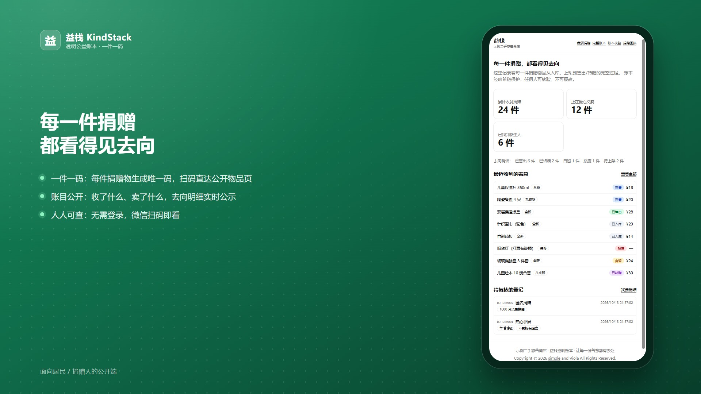
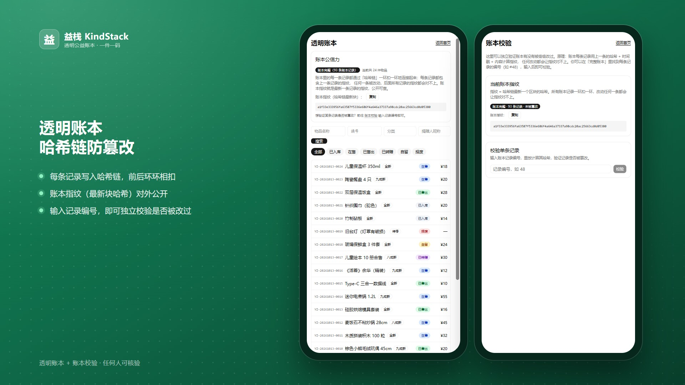
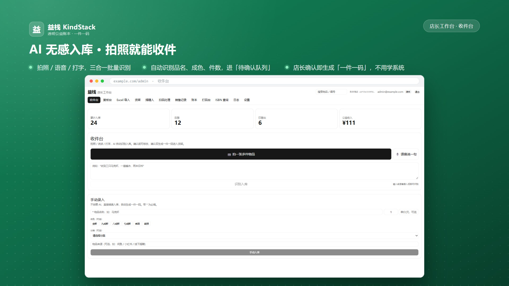
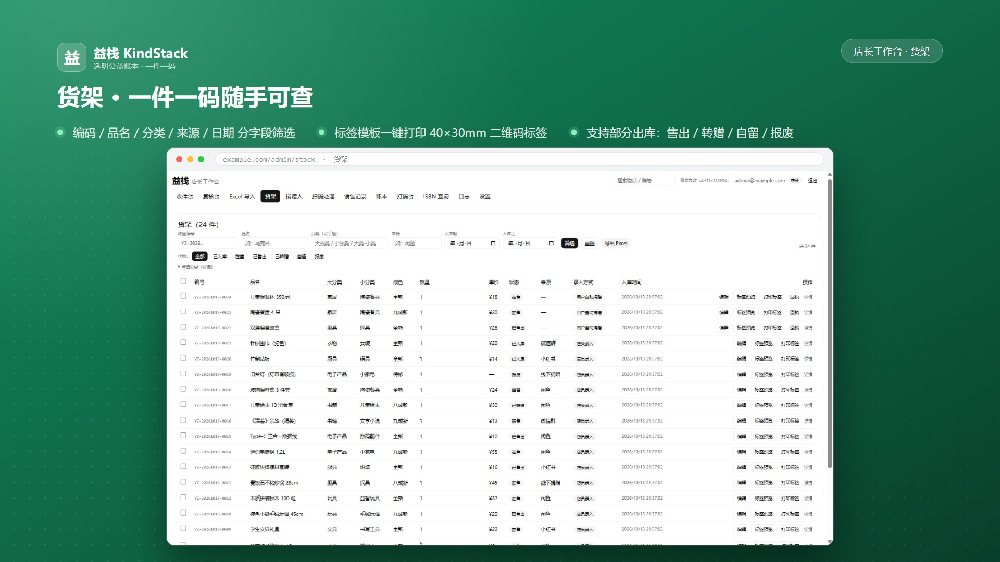
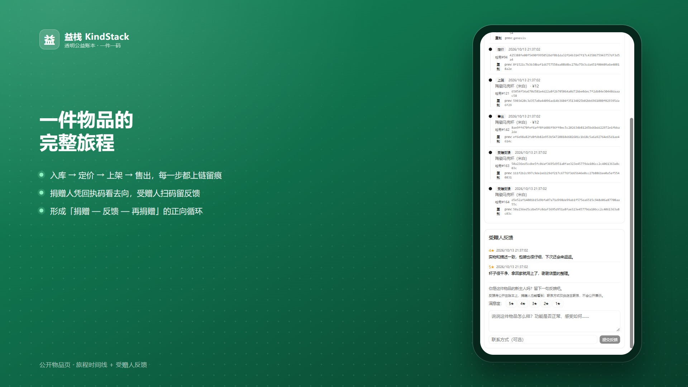
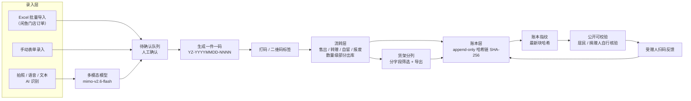

<div align="center">
  
  <h1>益栈 KindStack</h1>
  <p><b>面向二手慈善商店的轻量公益账本系统</b><br />
  一件一码 · 哈希链透明账本 · AI 无感入库</p>
  <p>
    
    
    
    
    
    
  </p>
</div>

> **给每件捐赠物品一件一码，让「收进来 → 卖出去 → 去哪里」全程公开、防篡改、可核验。**

---

## 界面预览

| 公开首页 · 每一件捐赠都看得见去向 | 透明账本 + 账本校验 |
|:---:|:---:|
|  |  |

| 收件台 · AI 无感入库 | 货架 · 一件一码随手可查 |
|:---:|:---:|
|  |  |

| 物品公开页 · 旅程时间线 + 受赠人反馈 |
|:---:|
|  |

---

## 目录

- [为什么做它](#为什么做它)
- [核心能力](#核心能力)
- [系统架构](#系统架构)
- [技术栈](#技术栈)
- [快速开始](#快速开始)
- [目录结构](#目录结构)
- [数据与隐私](#数据与隐私)
- [已知限制](#已知限制)
- [License](#license)

---

## 为什么做它

二手慈善商店每天收到来自全国各地的捐赠包裹：**小件居多、规格不一、几乎没有条码**。
走访中会发现三个层层递进的真实痛点：

1. **小件被忽略** —— 人工录入成本极高，现实中只能「大件入账、小件忽略」，大量善意没有进入任何记录。
2. **账目无法公开** —— 纸面 / 表格账本随时可以改，居民想查「收了什么、卖了什么」根本查不到。
3. **信任靠人情** —— 捐赠人寄出包裹后就没了下文，看不到去向，参与感流失。

传统方案都走不通：重型 ERP 为盈利流程设计，慈善商店用不上也维护不起；通用表格工具录入
仍是手工劳动，且**账目可随意修改、没有公信力**；真实区块链的多节点共识对一家社区小店是过度负担。

**益栈要的不是「库存管理系统」，而是一份可核验、有温度、能公开的善意账本。**

---

## 核心能力

| 能力 | 说明 |
|---|---|
| **一件一码** | 每件（或同款批次）生成唯一码 `YZ-YYYYMMDD-NNNN`，扫码直达公开物品页 |
| **AI 无感入库** | 拍照 / 语音 / 文本三合一，多模态模型批量识别品名、成色、件数，识别结果先进入「待确认队列」，由人确认后才落库 |
| **AI 定价建议** | 按品类 + 成色 + 同类历史成交均价给出建议价，店长一键确认或修改 |
| **哈希链透明账本** | append-only + SHA-256，每条记录包含上一条的哈希；篡改任意一条都会导致整链校验失败 |
| **账本指纹与校验** | 账本指纹（最新块哈希）对外公开；公开校验页可输入记录编号逐条核验 |
| **捐赠回执** | 捐赠人凭批量码查「我捐的东西去哪了」，逐件查看流转状态 |
| **受赠人反馈** | 受赠人扫码留寄语与评分，存库并写入账本，公开可查 |
| **自助登记 + 复核台** | 捐赠人在线登记 → 店长复核确认 → 生成一件一码与回执码（支持逐件通过 / 驳回） |
| **扫码流转与部分出库** | 扫码枪或手机摄像头扫码，售出 / 转赠 / 自留 / 报废；支持数量级部分出库（3 件售 2 剩 1） |
| **销售单与撤销** | 售出自动生成销售单，支持整单撤销与单件撤销，撤销动作同样记账本 |
| **标签模板与打印** | 40×30mm 二维码标签，模板可拖拽编辑、批量打印 |
| **分类、筛选与导出** | 两级分类树；编码 / 品名 / 分类 / 来源 / 日期分字段筛选；导出真 `.xlsx` |
| **角色与审计日志** | 店长 / 店员 / 捐赠人三类角色；操作日志 + 登录日志（IP、浏览器、系统），敏感字段脱敏 |
| **公开端匿名可读** | 首页总览 / 完整账本 / 账本校验 / 物品详情 / 捐赠回执，无需登录 |

---

## 系统架构



**分层说明**

| 层 | 职责 |
|---|---|
| 录入层 | Excel 批量导入、手动表单、AI 识别（拍照 / 语音 / 文本） |
| 确认层 | 待确认队列：AI 只做参谋，人确认后才生成正式记录 |
| 身份层 | 一件一码生成、二维码标签打印 |
| 流转层 | 售出 / 转赠 / 自留 / 报废，数量级部分出库 |
| 账本层 | append-only 哈希链、账本指纹、公开逐条校验 |
| 反馈层 | 受赠人扫码反馈，脱敏后归集入链 |

---

## 技术栈

| 层 | 选型 |
|---|---|
| 前端 / 服务端 | Next.js 16（App Router）· React 19 · TypeScript · Tailwind CSS · shadcn/ui |
| 数据层 | Drizzle ORM + SQLite（better-sqlite3），预留 MySQL 迁移（只改驱动，业务代码不动） |
| 鉴权 | Better Auth（邮箱 + 密码；微信扫码登录预留），Bearer Token 供移动端调用 |
| 账本 | 自研 append-only 哈希链（SHA-256），公开指纹 + 逐条校验 |
| AI | OpenAI 兼容端点 + `mimo-v2.6-flash`，可切换阿里云百炼 `qwen-vl-max` |
| 打印 / 条码 | bwip-js（二维码 / 条码），标签模板对接锐浪 Grid++Report（需自备，见「已知限制」） |
| 校验 | zod（所有对外入参） |

---

## 快速开始

```bash
# 1. 安装依赖（本项目使用 npm）
npm install

# 2. 配置环境变量
cp .env.example .env.local
#   - BETTER_AUTH_SECRET：openssl rand -base64 32
#   - AI_BASE_URL / AI_MODEL / AI_API_KEY：AI 通道（仅服务端读取）

# 3. 初始化数据库
npm run db:push     # 建表
npm run db:seed     # 店铺 / 角色 / 分类 / 店长账号

# 4. 启动
npm run dev         # http://localhost:3000
```

生成演示数据（可选，写入独立的演示库，不影响正式库）：

```bash
export DATABASE_URL="./data-demo/yizhan.db"   # Windows: $env:DATABASE_URL="..."
npm run db:push
ADMIN_EMAIL=admin@example.com ADMIN_PASSWORD=demo-pass-1234 npm run db:seed
npx tsx scripts/seed-demo.ts
```

**常用命令**

```bash
npm run build              # 生产构建（standalone 输出）
npm run start              # 生产启动
npm run db:verify          # 校验哈希链完整性
npm run db:clean-logs      # 清理过期日志
npm run grf:manifest       # 刷新标签模板清单
npm run dev:lan            # 绑定 0.0.0.0，便于局域网设备访问
```

**访问入口**

| 入口 | 路径 |
|---|---|
| 管理端（需登录） | `/admin/login` → `/admin`（收件台）、`/admin/stock`、`/admin/review`、`/admin/scan`、`/admin/labels`、`/admin/ledger`、`/admin/logs`、`/admin/settings` |
| 公开端（匿名） | `/`、`/ledger`、`/verify`、`/item/[code]`、`/receipt` |
| 捐赠人端（需登录） | `/account/login`、`/account/register`、`/account`；`/donate` |

---

## 目录结构

```
.
├─ src/
│  ├─ app/
│  │  ├─ admin/            # 登录 + (protected) 管理端
│  │  ├─ account/          # 捐赠人登录 / 注册 / 个人中心
│  │  ├─ api/              # 鉴权、条码、AI、移动端 REST API
│  │  ├─ item/[code]/      # 公开物品页
│  │  └─ ledger/ verify/ receipt/ donate/   # 公开端
│  ├─ db/                  # Drizzle schema（业务 + auth）
│  ├─ lib/                 # 业务逻辑：items / ledger / ai / sales / review / intake / 日志
│  └─ components/ui/       # 基础 UI 组件
├─ scripts/                # seed / verify / clean-logs / 演示数据
├─ drizzle/                # 迁移 SQL 与 schema 快照
└─ docs/                   # 方案与说明文档
```

---

## 数据与隐私

- 账本**只追加、不修改、不删除**；任何修正都以新增记录的方式留痕。
- 受赠人反馈中的联系方式仅供店主联系，**不在公开页展示**。
- 捐赠登记支持化名；操作日志与登录日志默认保留 30 天并自动清理。
- 所有对外 server action 入参经 zod 校验；写操作自动留痕（操作人 / 参数 / 结果 / 耗时）。
- 公开页面只展示物品名称、成色、状态、价格与去向，不涉及个人信息。

---

## 已知限制

- **标签模板需自备**：仓库不包含第三方打印控件（锐浪 Grid++Report）与其二进制模板文件，
  标签打印功能需自行获取控件并放置到 `public/gridpp/` 与 `public/grf/`。
- **移动端未包含在本仓库**：扫码枪 + 蓝牙标签打印的移动端工程为独立子项目，未随本仓库开源；
  服务端已提供 `/api/pda/*` REST 接口与 Bearer Token 鉴权，可按需对接。
- 数据库为单文件 SQLite，适合单机部署；多实例并发写场景建议迁移 MySQL（数据层已预留）。
- 演示环境若使用裸 IP + HTTP，摄像头扫码依赖 `BarcodeDetector`，需 HTTPS 或 localhost 才可用。

---

## License

[MIT](./LICENSE) © 2026 益栈 KindStack
